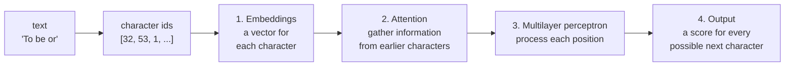

# TeenyTinyGPT

This sketch trains a teeny tiny GPT from scratch in your browser with TensorFlow.js.

This README and the code go through the following steps:



For this tiny GPT, the model predicts the next character based on a sequence of characters. This is exactly like a markov model, only the markov model looks up the probabilities for the next character from a table of counts! This model estimates the probabilities with a neural network whose weights are learned.

## 0. Text into numbers

```js
let unique = new Set(corpus);
vocab = Array.from(unique);
vocab.sort();
data = encode(corpus);
```

Every unique character in the text is a "token." The example dataset "tiny shakespeare" here has a total of 65 possible tokens. `encode()` is a function that turns the raw data into an array of ids, each one is an index into the `vocab` array.

(LLMs typically do not use single characters, but instead have tokens that are words or parts of words like `ing` or ` the`. They typically have vocabularies of 50,000+ tokens. Take a look at the [Tokenizer Playground](https://huggingface.co/spaces/Xenova/the-tokenizer-playground) to see how larger LLMs split text.)

## 1. Make Training Examples

`getBatch()` grabs a random 32-character block of the text (32 is the "context length")! The training target is that same snippet but shifted by one character.

```js
inputs.push(data.slice(start, start + contextLength));
targets.push(data.slice(start + 1, start + contextLength + 1));
```

| position | 0   | 1   | 2   | 3   | 4   | 5   | 6   | 7   |
| -------- | --- | --- | --- | --- | --- | --- | --- | --- |
| input    | T   | o   | ␣   | b   | e   | ␣   | o   | r   |
| target   | o   | ␣   | b   | e   | ␣   | o   | r   | ␣   |

Each block of 32 characters is actually then 32 training examples at once! After "T," predict "o"; after "To," predict a space; after "To ␣," predict "b"; after "To b," predict "e"; and so on.

A batch is 32 of these blocks, so each training step makes 32 × 32 = 1,024 predictions. The `inputs` tensor has the shape `[32, 32]` (batch, length). (These numbers don't have to be the same!)

## 2. Embeddings

Now it's time to create an "embedding" for each token.

```js
this.tokenEmbedding = tf.layers.embedding({ inputDim: vocabSize, outputDim: embedSize });
this.positionEmbedding = tf.layers.embedding({ inputDim: contextLength, outputDim: embedSize });
```

We need an embedding of `embedSize` length for all 65 tokens (`vocabSize`). It will start out random, and the training process will adjust them like any other weight in a neural network.

The second variable `positionEmbedding`, has a vector not for a token but for every position in the context (0 to 31). This is added to the token embedding.

```js
embed(inputs) {
  let length = inputs.shape[1];
  // Token embedding
  let tokens = this.tokenEmbedding.apply(inputs);
  // Positional embedding
  let positions = this.positionEmbedding.apply(tf.range(0, length, 1, 'int32'));
  // Add the two together, so each position has a unique vector
  return tokens.add(positions);
}
```

The result has the shape `[32, 32, 64]` (`[batch, context length, embedSize]`). A batch is 32 snippets, each with 32 tokens, each with an embedding of 64 numbers.

## 3. Attention

So it's technically possible to skip attention and send each position's vector straight into a multilayer perceptron (vanilla neural network!) to predict the next character. However, if we did this, for any given position, the perceptron only knows that it's looking at a single character. It could, for example, learn that "e" is often followed by a space or an "r," but it can't tell whether this "e" is the end of "the" or the middle of "never." That's a Markov chain of order 1!

You can see what happens without attention. In `gpt.js`, comment out the attention line in `predict()`:

```js
// x = x.add(this.attention(x).output);
```

Without attention training only gets to a loss around 2.5.

**Attention is how each token gathers information from the tokens before it.**

## 4. Attention

Attention involves three weight matrices that each perform a different function.

- **query**: what am I looking for?
- **key**: what do I have that someone might be looking for?
- **value**: what do I pass along if someone looks at me?

These weight matrices (dense layers) are applied to the inputs (`x`).

```js
let q = this.query.apply(x);
let k = this.key.apply(x);
let v = this.value.apply(x);
```

To get scores, you then calculate the dot product of every query with every key. A dot product compares the direction of vectors, you get a higher number when two vectors are similar (pointing the same way). A high score means "this key matches what this query is looking for" or "pay attention!!" For each training sample, the result is a 32 × 32 grid: row _i_ holds position _i_'s scores for every position _j_. (The `false, true` tells `matMul` to transpose `k`, so that `[32, 64] × [64, 32]` gives us `[32, 32]` which is what we want for the next step.)

```js
let scores = tf.matMul(q, k, false, true);
```

These numbers can get very large which can throw off softmax so it's good to scale them down.

```js
scores = scores.div(Math.sqrt(this.embedSize));
```

When a given position is learning to predict the next character, it must not be allowed to see that character, that's the answer! While we're at it, it shouldn't see anything later either. So this is where the mask comes in, adding a big negative number to every score that looks into the future, saying "Look away! Pay no attention to this position!".

```js
scores = scores.add(this.mask.slice([0, 0], [length, length]));
```

|       | T    | o    | ␣   | b   |
| ----- | ---- | ---- | --- | --- |
| **T** | 0.4  | −∞   | −∞  | −∞  |
| **o** | 1.2  | 0.3  | −∞  | −∞  |
| **␣** | −0.5 | 2.1  | 0.8 | −∞  |
| **b** | 0.9  | −0.2 | 1.7 | 0.1 |

The mask is what lets one sample train all 32 positions at once.

Finally, softmax turns each row of scores into weights that add up to 1: how much attention position _i_ pays to each earlier position _j_. Anything that was −∞ becomes 0.

```js
let weights = tf.softmax(scores);
```

Well, actually finally, each position's output is the weights multiplied by the values (here's what gets passed to me from who I'm paying attention to!)

```js
let output = tf.matMul(weights, v);
```

### An example example

Take the three characters "c a t," with an embedding size of 2 instead of 64. Here are some made up embeddings:

| char | x      |
| ---- | ------ |
| c    | (1, 0) |
| a    | (0, 1) |
| t    | (1, 1) |

The query, key, and value layers are each a 2×2 matrix. Here are some made-up ones (these are learned during the training process):

```
query          key            value
[ 1  0 ]       [  1  0 ]      [ 1  1 ]
[ 1  0 ]       [ -1  1 ]      [ 0  1 ]
```

Each token's query is the result of multiplying its embedding by the query matrix (the embedding dot product with one column of the matrix.) So for the character "t" with embedding (1, 1):

```
q, 1st number:  1×1 + 1×1    = 2
q, 2nd number:  1×0 + 1×0    = 0
→ q = (2, 0)

k, 1st number:  1×1 + 1×(−1) = 0
k, 2nd number:  1×0 + 1×1    = 1
→ k = (0, 1)

v, 1st number:  1×1 + 1×0    = 1
v, 2nd number:  1×1 + 1×1    = 2
→ v = (1, 2)
```

Doing the same for every character gives:

| char | q      | k       | v      |
| ---- | ------ | ------- | ------ |
| c    | (1, 0) | (1, 0)  | (1, 1) |
| a    | (1, 0) | (−1, 1) | (0, 1) |
| t    | (2, 0) | (0, 1)  | (1, 2) |

Here are the steps for the last character "t". Its query is (2, 0).

1. Scores. This is then the dot product of "t"'s query with each character's key.

   ```
   t's q · c's k:  (2, 0) · (1, 0)  = 2×1 + 0×0    =  2
   t's q · a's k:  (2, 0) · (−1, 1) = 2×(−1) + 0×1 = −2
   t's q · t's k:  (2, 0) · (0, 1)  = 2×0 + 0×1    =  0
   ```

2. Scaled by √2 (embedding size): [1.41, −1.41, 0].
3. Softmax: [0.77, 0.05, 0.19]
4. Output then calculates a weighted average of the values: 0.77 × (1, 1) + 0.05 × (0, 1) + 0.19 × (1, 2) = **(0.96, 1.20)**.

In this case, "t" is paying a lot of attention to "c"!

And remember, these values are not set by anyone! The query, key, and value weights are learned with the same gradient descent algorithm as any neural network.

## 5. Residual connections

One other little trick is that the attention's output is added to `x` rather than replacing it. This is known as a "residual connection." Each position keeps its original embedding, and attention adds what it gathered on top, so nothing is lost along the way. This also makes the model easier to train.

```js
x = x.add(this.attention(x).output);
```

## 6. The multilayer perceptron

Finally, it's time for the "vanilla" neural network layer!

```js
// The hidden layer is 4x bigger than the embedding size, and uses ReLU activation
this.hidden = tf.layers.dense({ units: embedSize * 4, activation: 'relu' });
this.mlpOutput = tf.layers.dense({ units: embedSize });
```

And the result of this is another "residual connection."

```js
x = x.add(this.mlpOutput.apply(this.hidden.apply(x)));
```

This perceptron runs on every position separately!

You can think of the attention part as passing information between positions, and the perceptron as processing that information for each position. In large models, a lot of what the model "knows" seems to live in these perceptron layers. For more, see 3Blue1Brown's [How might LLMs store facts](https://www.3blue1brown.com/lessons/mlp).

## 7. Output: a score for every character

```js
this.output = tf.layers.dense({ units: vocabSize });
```

One last dense layer turns 64 numbers into 65 scores (one for each token), called **logits**. It does this for every position! And again, softmax turns the scores into probabilities.

## 8. Loss

Now it's time to compare the final output logits (the guesses) to the correct answers!

```js
let answers = tf.oneHot(targets, this.vocabSize);
return tf.losses.softmaxCrossEntropy(answers, logits);
```

Cross-entropy loss is −log(the probability the model gave to the correct next character), averaged over all of the predictions in the batch (32x32). (FYI `log` is the natural log (base e), the same as p5's `log()`.)

Without any training the model would guess evenly among 65 characters, so you should see a loss of around −log(1/65) ≈ 4.17. A perfect model would give the right answer a probability of 1 and you'd have a loss of 0! If you get to a loss of around 1.8, that means the model is, on average, about as unsure as if it were choosing between e^1.8 ≈ 6 equally likely characters instead of 65. That number (e to the power of the loss) is called **perplexity**.

## 9. Training

```js
let loss = this.optimizer.minimize(() => { ... }, true); // true: give back the loss so we can graph it
```

`minimize()` runs backpropagation: it works out how much each of the model's roughly 56,000 weights contributed to the loss, and nudges every one of them a little in the direction that makes the loss smaller.

This is the same supervised learning process as described in Chapter 10 in the [Nature of Code](https://natureofcode.com/neural-networks/) (guess, calculate error, adjust). The difference here is that the answers come from the training text itself, i.e. "self-supervised."

## 10. Generating

Once the model is trained, all you need to do is feed in a context window of 32 characters, calculate a prediction at the last position, pick a character with weighted random selection, add it to the text, and repeat. The model never writes a sentence!

```js
let context = encode(generated.slice(-contextLength));
let probabilities = gpt.nextCharacter(context, temperature);
let next = vocab[pickIndex(probabilities)];
generated += next;
```

The model can see only the last 32 characters, this is a very small **context window**.

## TinyGPT vs GPT

|                    | TinyGPT                | GPT-2 small (2019) | Llama 3 8B (2024)   |
| ------------------ | ---------------------- | ------------------ | ------------------- |
| Tokens             | 65 tokens (characters) | 50,257 tokens      | 128,256 tokens      |
| Context window     | 32                     | 1,024              | 8,192               |
| Numbers per token  | 64                     | 768                | 4,096               |
| Attention heads    | 1                      | 12                 | 32                  |
| Transformer blocks | 1                      | 12                 | 32                  |
| Parameters         | ~56 thousand           | 124 million        | 8 billion           |
| Training text      | 1 MB                   | ~40 GB (WebText)   | 15+ trillion tokens |

Some other things missing here!

- **Multiple attention heads.** This example only has one attention head! A larger model will include many all running in parallel, each learning something different about the text's relationships. Their outputs are joined back together afterwards.
- **More blocks.** Multiple Attention heads + a perceptron make up a single block. Larger LLMs will have many of these!
- **Layer normalization** Scaling the numbers before each attention layer and each perceptron to keep the values in a range that will work for larger architectures.
- **GELU** A different activation function that is a smoother curve.
- **Validation loss.** If you have a lot of training data, it is standard to save some of it to test the model ("validation"). This helps catch the model just memorizing the data ("overfitting").

And of course, there's the larger token vocabulary, massive context windows, trillions of tokens of training text, and thousands of GPUs. Oh, and an additional process called "post-training" that steers the model into behaving like a chat bot.

## Things to try

1. Turn off attention! What happens?
2. Try different values for `contextLength`. 8? 64?
3. Try different values for `embedSize` 16? 128?
4. Try varying `temperature`.
5. Try your own data! You'll probably want at least 100KB of text.
6. **Add a second block.** This is hard! You'll have to have a whole second set of query, key, value, and perceptron layers. `attention()` uses `this.query`, `this.key`, and `this.value` directly, so you'll need to change it to take which layers to use. Then repeat the two `x = x.add(...)` lines in `predict()` with the second set.

## References

- 🎥 [Attention in transformers, step-by-step](https://www.3blue1brown.com/lessons/attention) by 3Blue1Brown
- 🔗 [Transformer Explainer](https://poloclub.github.io/transformer-explainer/): an interactive GPT-2 running in your browser
- 📚 [The Illustrated Transformer](https://jalammar.github.io/illustrated-transformer/) by Jay Alammar
- 🎥 [Let's build GPT: from scratch, in code, spelled out](https://www.youtube.com/watch?v=kCc8FmEb1nY) by Andrej Karpathy (the Python version of this, in two hours)
- 📚 [Attention Is All You Need](https://arxiv.org/abs/1706.03762) (Vaswani et al., 2017): the original transformer paper
